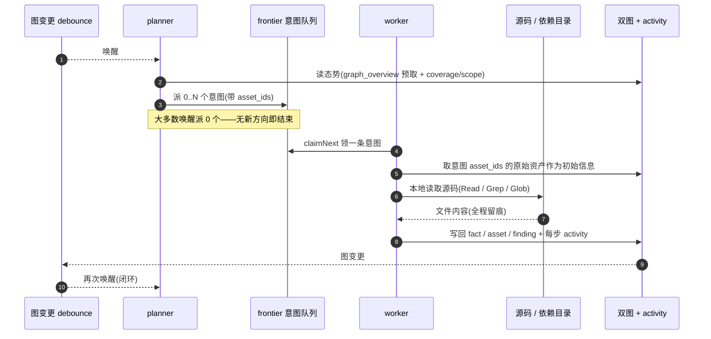
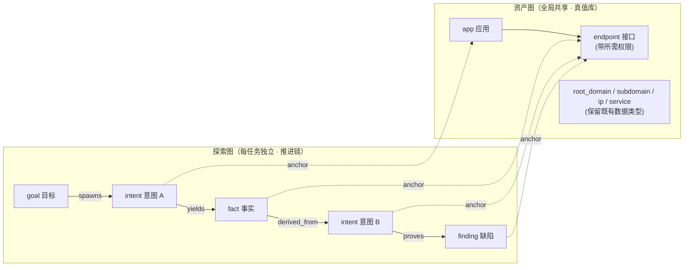
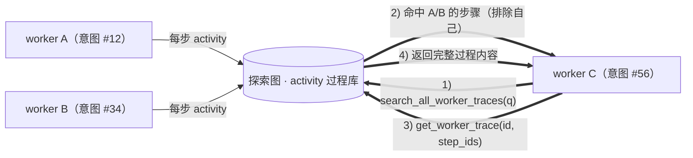
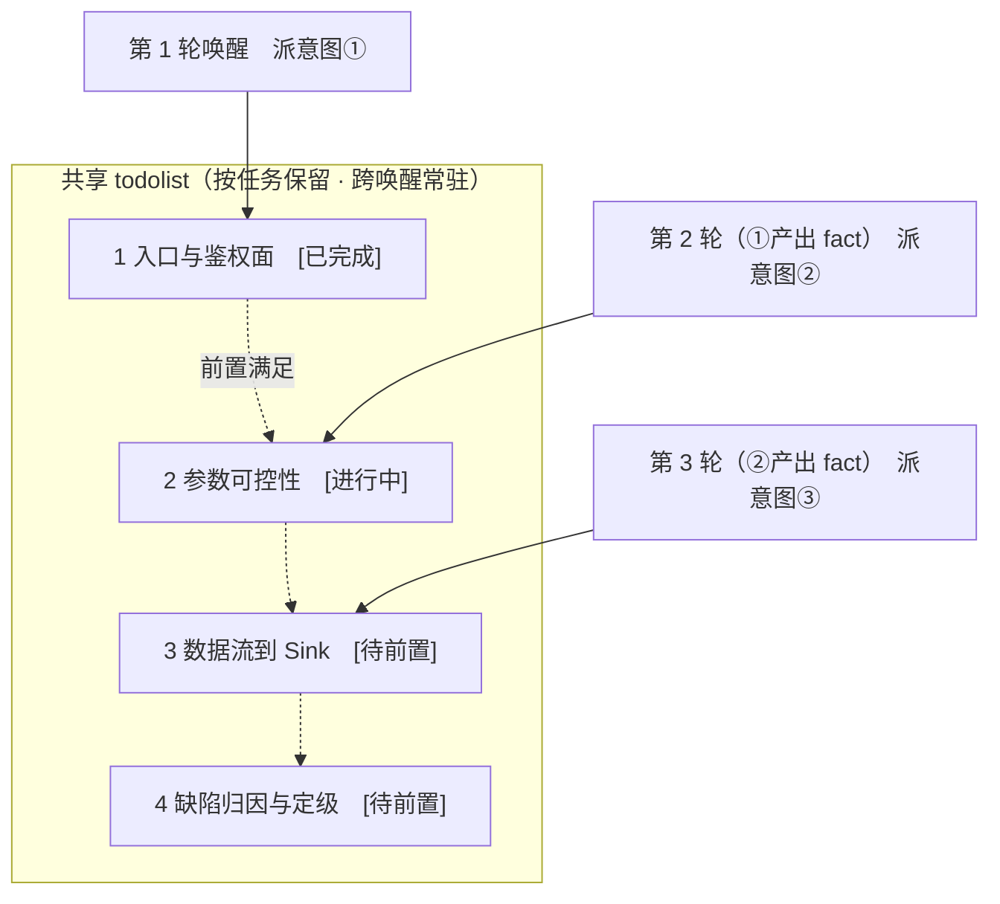
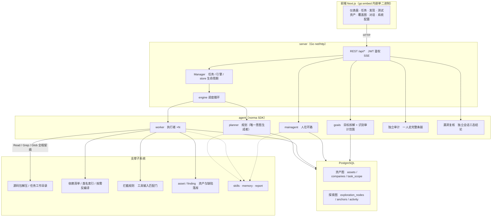

<div align="center">

# SCA Audit

LLM 多 Agent 驱动的 **静态代码审计平台**（Go 后端 + Next.js 前端）

</div>

---

## 这是什么

SCA Audit 把「审计一个代码仓库」拆成**可并行的意图**，交给多个 LLM Agent 分工静态读完源码，把结果写成两张可回溯的图：**资产图**（这个系统对外暴露了什么）与**探索图**（我们是怎么一步步查到结论的）。

它和扫描器的区别在于**产出物**：

| | 扫描器 / SAST 规则 | SCA Audit |
| --- | --- | --- |
| 输入 | 代码 | 代码（**只读**） |
| 产出 | 规则命中列表 | **接口清单 + 每条接口所需权限**、缺陷结论（带 `文件:行号` + 代码片段）、依赖可达性判定 |
| 判断依据 | 模式匹配 | 读完整条**数据流**：参数从哪来 → 过没过校验 → 到没到 Sink |
| 误报处理 | 人工逐条看 | **独立会话复核**，结论三态回写漏洞状态 |
| 过程 | 黑盒 | 探索图 + 每次工具调用留痕，可复算 |

**只做静态分析。** 平台不发起任何网络请求、不执行任何系统命令、不做任何运行时验证——结论必须由源码证据支撑。这不是靠提示词约束，而是**在工具装配层物理删除**（见下节）。

---

## 安全边界（红线）

`agent/codeaudit_tools.go` 是「Agent 能调用什么」的唯一真源。工具来源侧是**三层防线**，缺一不可；写入侧另有拦截规则兜底：

**① Agent 的通用工具集只从 7 个本地文件工具构造**

```
Read · Write · Edit · MultiEdit · LS · Glob · Grep
```

没有 `Bash`。没有 `WebFetch` / `WebSearch`。其余全是平台自己的领域工具（登记资产、写回图、登记漏洞、依赖查询、复核结论）。

**② 装配层不再注入危险来源**

`server/hostTools()` 不返回流量工具、自定义工具与 MCP；`server/assembly.go` 不再展开 MCP 服务器——所以**连 `mcp__*` 工具都不会出现在 Agent 的工具列表里**。

**③ 兜底黑名单：配置也绕不过去**

即使有人往 DB 的 `tools` 表、可见性配置或宿主工具里塞进危险工具，也会在 `AugmentTools` 的最后一步按名字剔除：

```go
var codeAuditDeniedTools = []string{
    "bash", "shell", "shell_session", "sleep", "monitor",
    "webfetch", "websearch", "web_search", "fetch", "curl", "wget", "http", "http_request",
    "command", "script",              // 自定义工具的 command / script kind（http kind 的 key 就是 "http"，已在上行）
    "task", "taskoutput", "taskstop", "tasklist",   // 子代理会把上述能力递归带进去
    "mcp__*", "traffic_*",
    "intercept_execute", "intercept_approve",
    "browser*", "playwright*", "selenium*",
    "nmap*", "nuclei*", "sqlmap*", "ffuf*", "dirsearch*", "hydra*", "metasploit*",
    "create_custom_tool", "update_custom_tool", "create_mcp", "update_mcp", "test_custom_tool",
}
```

**④ 写入侧还有拦截规则**

被测源码是审计证据，任何改动都会让结论不可复现。内置规则按优先级匹配**序列化的工具输入**，首条命中即生效；规则可在「系统设置 → 命令拦截」里关闭、修改或删除：

| 优先级 | 规则 | 匹配 |
| --- | --- | --- |
| 100 | 系统破坏性命令 | `rm -rf`、删除系统关键目录、`mkfs`、`dd of=/dev/*`、fork 炸弹、`shutdown` / `reboot`、`kill -9 -1`、`shred` / `wipe`、清空防火墙 |
| 90 | 数据库破坏性操作 | `DROP DATABASE/TABLE/...`、`TRUNCATE`、Mongo `drop`、Redis `FLUSHALL` / `FLUSHDB` |
| 80 | HTTP DELETE 请求 | `curl -X DELETE`、Python `requests.delete(`、`method: 'DELETE'` |
| 80 | 清空 / 删除类接口路径 | `/clear`、`/wipe`、`/delete...`、`/remove...` 等 |
| 80 | 数据外泄管道（默认关闭） | 命令输出经 `curl` / `wget` / `nc` 外传 |

默认进入拦截层的工具是 `Write` / `Edit` / `MultiEdit`（`Bash`、`WebFetch`、`shell_*` 在本平台装配层就不存在）。命中 `deny` 的调用直接拒绝并记入任务详情的「拦截审批」，只有 `ask` 类规则才会挂起等人工裁决。

---

## 截图预览

| 仪表盘（总览 / Token 消耗 / 活动流） | 任务列表 |
| :---: | :---: |
|  |  |

| 任务 · 执行过程（会话 / 工具调用） | 探索链路（意图 · 事实 · 漏洞血缘） |
| :---: | :---: |
|  |  |

| 发现（跨任务漏洞汇总 · 按严重度 / 任务分组） | 漏洞复核（三态结论 + 逐条核对依据） |
| :---: | :---: |
|  |  |

| 测试资产 · 接口与**所需权限** | 资产覆盖图（力导向 · 已测高亮 · 节点折叠） |
| :---: | :---: |
|  |  |

| 第三方依赖（清单 / 类名索引 / 按需反编译） | 人在环路对话 |
| :---: | :---: |
|  |  |

| Agent 管理（提示词 / 工具 / 技能可见性） | LLM 配置（多档位 · 轮询与退避） |
| :---: | :---: |
|  |  |

| 后端日志（工具调用 / 拦截 / 依赖索引） |
| :---: |
|  |

---

## 一次审计是怎么跑的

### 引擎与意图生命周期

引擎是**事件驱动**的闭环：图一变就唤醒 planner，planner 派意图，worker 领意图执行并写回，写回又触发下一轮——直到目标被证明（`prove_goal`）。



> **worker 的工作目录**是意图目录 `tasks/<taskID>/i<intentID>`，因此代码在 `../source`、第三方依赖在 `../deps`。

### 双图架构：探索图 + 资产图

系统把「**要查什么**」和「**查到了什么程度**」拆成两张相互独立、又通过锚点相连的图：



- **资产图（全局共享）**：跨任务同一份的资产真值库，`exploration_anchors(node_id, asset_id)` 把探索节点锚定到具体资产。代码审计主要产出 **`app`（应用）** 与 **`endpoint`（接口）** 两类节点；接口节点带 `url / method / params / permission / file / line`。父子关系与去重 key 全部由程序计算，Agent 只提交原始信息。
- **探索图（每任务独立）**：节点为 `goal / intent / fact / finding / hint`，靠 `spawns / derived_from / yields / proves` 连成**血缘链**，回答「哪个方向派生自哪些事实、产出了什么缺陷」。
- 两图相连后，既能从「探索方向」看它查的是哪些接口，也能从「某个接口」反查它在本任务被哪些意图读过、得出过哪些事实——这支撑了**资产测试覆盖度**与**资产覆盖图**（范围内资产 + 已测高亮）。

### 接口权限判定（本平台的核心产出）

每个接口都要判定「**谁能调**」，取值六档：

`公开` / `注册用户` / `登录用户` / `管理员权限` / `内部接口` / `其他`

判定依据按优先级：① 网关白名单（最外层，命中即「公开」）② 类/方法级鉴权注解（`@PreAuthorize`、`@Secured` 等）③ 自研鉴权工具类与拦截器 ④ 路由分组与中间件注册范围。

两条容易判错的规则，平台按代码**实际生效**的边界记：

- **中间件兜底会骗人**：网关只验 token 有效性的路径，后端如果没注解，实际权限是「登录用户」而不是「管理员权限」——这类「标注权限 ≠ 实际权限」的接口会单独报出来。
- **没看到任何鉴权校验、且不在白名单豁免清单里的接口，一律按「内部接口」处理**——未鉴权、内网专用、调试/管理接口是最重要的发现。

### 第三方依赖（SCA）与可达性

任务目录下的 `deps/` 是**清单 + 按需反编译产物**，和 `../source` 是两回事：默认一个 jar 都没被反编译，里面通常只有 `../deps/INDEX.md`（依赖清单）和 `../deps/index/classes.txt`（类名索引）。

看依赖源码的正确顺序是三步，而不是盲扫：

1. 先 `Grep ../deps/index/classes.txt` 定位「这个类在哪个依赖里」（很便宜）；
2. `list_dependencies` 看坐标、版本与源码状态；
3. **只对确有必要的那一个**依赖调 `ensure_dependency_source(gav="group:artifact:version")`，它把该 jar 变成可读源码并返回**落盘路径**（不会把整包代码倒进上下文），拿到路径后自己 `Read` / `Grep`。

> 实测一个 1.7 MB 的 jar 反编译要 40~60 秒，所以平台不提供「全部反编译」。**反编译产物不是原始源码**（行号、结构、变量名都可能不同），引用时必须注明。

**可达性三步**（缺一步都不算缺陷）：

| 步骤 | 怎么做 | 判不通过的典型情形 |
| --- | --- | --- |
| ① 版本命中 | `pom.xml` / `build.gradle` 的坐标与版本落在已知漏洞区间 | **这一步只是候选，不是结论** |
| ② 调用点可达 | `Grep` 该组件的类是否被业务代码 `import` / 调用 | 没有 import → 直接排除 |
| ③ 入参可控 | 命中的那处调用，参数是否来自请求或外部数据 | 参数是常量 / 内部可信值 / 已被白名单约束 |

只有三步全过才登记为漏洞。**仅凭版本命中 CVE、或「用了字符串拼接」就上报是被明令禁止的**——嫌疑项只能记为「存疑/待核实」。

### 漏洞复核（独立会话 · 三态结论）

从漏洞详情或列表手动发起，平台会拉一个**独立的复核 Agent 会话**，它只复核这一个漏洞：重新核对触发路径是否可达、危险输入是否可控、关键校验是否真的缺失、原证据（`文件:行号` + 代码片段）是否真实存在且没断章取义。**主动证伪优先**——存在有效校验、路径不可达、仅测试/死代码、只靠版本推断，都算复核通过（方向相反）。

结论三态，会话成功结束且结论为 `confirmed` 时，系统自动把漏洞状态改为「已确认」；`refuted` 改为「误报」；`inconclusive`（缺源码、反编译不可读）保留原状态：

| verdict | 含义 | 联动 |
| --- | --- | --- |
| `confirmed` | 漏洞真实：触发路径、可控输入、危险操作三者闭合 | 状态 → 已确认 |
| `refuted` | 漏洞不成立：证据被证伪或不足以支撑结论 | 状态 → 误报 |
| `inconclusive` | 缺源码或证据，无法判定（需写清缺什么） | 状态不变 |

原证据与报告始终保留，复核只新增独立结论。同一漏洞正在复核时复用已有会话。

### worker 间的过程级信息交换

一次深入的审计里，很多有价值的观察（某个入口没走鉴权、某个参数一路没被校验、某个配置被另一个 profile 覆盖）出现在一个 worker 的**执行过程**中，却未必被写成正式 fact。为避免重复劳动，worker 可以**跨 work 检索过程**：



这样即便探索图上还没有对应的 fact，后续 worker 也能复用他人过程中的观察——**信息以「执行过程」为粒度在 worker 之间流动**，而边界不变（每个 worker 仍只做自己领到的那条意图）。

### planner 多轮共享 todolist → 稳定的审计链路

真实审计链往往**有前后依赖**（如：确认入口未鉴权 → 追踪该入口的参数是否可控 → 沿调用链走到 Sink → 判定缺陷成立），一次性并行派下去只会乱套。planner 因此持有一份**按任务保留、跨唤醒共享的规划待办**：



每轮只对「前置步骤已完成、其依赖的 fact 已存在」的下一步派意图，并随进展更新清单。于是审计链在「事件驱动 + 每次唤醒是全新会话」的环境下依然**稳定推进、不重复、不错序**。

### 两层 Agent：编排循环 + 独立审计



| 层 | 职责 |
| --- | --- |
| **前端** | Next.js 静态导出，`go:embed` 内嵌进单二进制；可视化任务 / 资产 / 探索链路 / 覆盖图，人在环路对话 |
| **server** | `net/http` 路由 + JWT 鉴权 + SSE；`Manager` 托管任务、引擎、DB store 的生命周期 |
| **engine** | 每任务一个 `plannerLoop` + N 个 worker goroutine；意图领取、超时 / 暂停 / drain |
| **agent** | goals / planner / worker / mainagent 的编排循环，外加两个单脑 Agent：独立审计、漏洞复核 |
| **db** | 双图的 Postgres 落地（pgx）；schema 随 `go:embed` 每次启动幂等建表 |
| **支撑** | 源码包解压与工作目录、依赖索引与按需反编译、拦截门、技能 / 记忆 / 报告 |

---

## 安装

> 依赖 **PostgreSQL**、**Go >= 1.26**；内嵌前端还需要 **Node.js / npm**。需配置 **LLM**（`ANTHROPIC_API_KEY` 或 `OPENAI_API_KEY`，也可在 UI 里配）。

### 从源码编译（唯一安装方式）

```bash
git clone https://github.com/Ernket/CodeScan-Artex.git
cd CodeScan-Artex
cp config.example.json config.json   # 填好 database 连接
# 1) 前端静态导出
cd web && npm ci && npm run build:static && cd ..
# 2) 拷进内嵌目录
cp -r web/out server/webui/dist
# 3) 编译（-tags embedui 才内嵌前端）
CGO_ENABLED=0 go build -tags embedui -trimpath -o artex ./cmd/artex
# 4) 启动
./start.sh                           # → http://localhost:7878
```

也可以直接运行 `./install.sh`：交互式填写数据库连接 → 生成 `config.json` → 编译并启动。

> 请用 `start.sh` / `start.bat` 启动，而不是直接跑 `./artex`。它是个守护脚本：程序异常退出时按退出码决定是否重新拉起。
> 后台常驻：`nohup ./start.sh >artex.log 2>&1 &`。

首次访问 `/setup` 设置管理员密码。

### 账号、部门与权限

平台是多用户的：账号存在 `users` 表（`is_admin` 区分管理员/普通用户），任务按**部门**隔离。

- **管理员**：账号管理（建号、改密、停用、提升/取消管理员）、部门管理（建部门、分配成员的部门与角色）、可查看全部任务。
- **普通用户**：只能看到自己创建的、以及自己所属部门下的任务。
- **部门角色**：`owner`（部门所有者）可对话、创建/暂停/删除任务；`visitor`（部门访客）只读——不能对话、不能创建任务、不能暂停/删除。
- 首次部署访问 `/setup` 创建管理员；之后账号的密码忘记时用仓库里的重置脚本（连库直接改 bcrypt 哈希，无需重启）：

```bash
./reset-password.sh                          # 默认重置 admin，交互输入新密码
./reset-password.sh -u someone -p 'NewPass!' # 重置指定账号
```

---

## 更新升级

> 升级只换程序、不动数据：Postgres 数据库、`./data`（`jwt.key` 等）、`./skills` 都会保留。**数据库迁移无需手动执行**——`artex` 每次启动会幂等重跑 `schema.sql`（含 `ADD COLUMN` / `CREATE INDEX IF NOT EXISTS`），即“重启即迁移”。升级前仍建议先备份 `./data` 与数据库。

### 从源码编译更新

```bash
git pull
cd web && npm ci && npm run build:static && cd ..
cp -r web/out server/webui/dist
CGO_ENABLED=0 go build -tags embedui -trimpath -o artex ./cmd/artex
# 重启 ./start.sh
```

也可以直接运行 `./update.sh`：可选 `git pull` → 重建前端 → 重新编译，完成后重启进程生效。

---

## 配置

**数据库**（`config.json`，或用环境变量 `ARTEX_PG_DSN` 覆盖）：

```json
{
  "database": {
    "host": "127.0.0.1", "port": 5432,
    "user": "artex", "password": "yourpass",
    "dbname": "artex", "sslmode": "disable"
  }
}
```

**LLM**：`export ANTHROPIC_API_KEY=sk-...`（或 `OPENAI_API_KEY`），也可在 UI 的「LLM 配置」页填写。
可选：`ARTEX_LLM_PROVIDER` / `ARTEX_LLM_MODEL` / `ARTEX_LLM_BASE_URL` / `ARTEX_LLM_PROXY`。

**并发**：每个任务的 work agent 数在「系统设置」里配置（默认 3）。

**常用环境变量**：

| 变量 | 作用 |
| --- | --- |
| `ARTEX_PG_DSN` | 直接给出 Postgres 连接串，优先于 `config.json` |
| `ARTEX_SKILL_DIR` | 技能根目录（默认可执行文件旁的 `skills/`） |
| `ARTEX_LLM_PROVIDER` / `ARTEX_LLM_MODEL` / `ARTEX_LLM_BASE_URL` | 覆盖 LLM 供应商 / 模型 / 端点 |

**常用启动参数**：`./start.sh -addr :7878`（`-addr` 前端 + API，默认 `:7878`）。启动脚本会把参数原样透传给 `artex`。

### Java 依赖读取与反编译（可选）

平台读第三方 jar 需要 `java` + 一个反编译 jar。**不配也能用**——依赖清单 `INDEX.md` 与类名索引 `index/classes.txt` 始终可用，`list_dependencies` 正常返回坐标、版本与源码状态，只是「按需反编译」会报不可用。

探测顺序：**显式配置 / 环境变量 → `<data>/tools/` 下的 jar → PATH 里的 `java`**。

| `config.json`（`java.*`） | 环境变量 | 说明 |
| --- | --- | --- |
| `java_path` | `ARTEX_JAVA_PATH` | `java` 可执行文件；留空则搜 PATH |
| `vineflower_jar` | `ARTEX_VINEFLOWER_JAR` | Vineflower（需 JRE 17+，多线程、对新版 Java 支持更好，**优先**） |
| `cfr_jar` | `ARTEX_CFR_JAR` | CFR（JRE 6+ 即可运行，**兜底**） |
| `timeout_seconds` | `ARTEX_DECOMPILE_TIMEOUT` | 单个 jar 的反编译上限，默认 180 秒 |
| `max_heap` | `ARTEX_DECOMPILE_MAX_HEAP` | 反编译 JVM 堆上限，默认 `2g` |
| `local_repo` | `ARTEX_JAVA_LOCAL_REPO` | 本地 Maven 仓库（通常 `~/.m2/repository`），**只读** |

```json
{
  "java": {
    "java_path": "/usr/bin/java",
    "cfr_jar": "/app/data/tools/cfr-0.152.jar",
    "local_repo": "/root/.m2/repository",
    "timeout_seconds": 180,
    "max_heap": "2g"
  }
}
```

配好 `local_repo` 后，任务可以按 `group:artifact:version` 直接从本地仓库取 jar（**硬链接**进任务自己的 `deps/jars`，从不写入仓库），不必每次手工上传——这才是「配一次、每个任务都受益」。仓库路径写错会降级为「只能上传」，不会让依赖处理整体坏掉。

### 反向代理部署（HTTPS / 只开放 443）

前端和 API/SSE 都由同一个后端端口（默认 `:7878`）提供，实时活动流默认走**同源**地址，因此**无需配置 `NEXT_PUBLIC_SSE_BASE`**，公网只开放 443、把 7878 留在内网即可。

SSE 是长连接 + 持续推送，反代**必须关闭缓冲**，否则浏览器能连上却收不到事件（表现为活动流一直转圈）。Nginx 示例：

```nginx
server {
    listen 443 ssl;
    server_name your.domain.com;
    # ssl_certificate / ssl_certificate_key ...

    location / {
        proxy_pass http://127.0.0.1:7878;
        proxy_set_header Host $host;
        proxy_set_header X-Forwarded-Proto $scheme;

        # SSE 关键项：关缓冲、长超时、HTTP/1.1
        proxy_buffering off;
        proxy_cache off;
        proxy_read_timeout 3600s;
        proxy_http_version 1.1;
        proxy_set_header Connection "";
    }
}
```

> 仅当 SSE 需要走与页面不同的来源（如独立子域）时，才在**构建期**设置 `NEXT_PUBLIC_SSE_BASE`（该变量在 `next build` 时固化进静态包，容器运行时再设无效）。

---

## 开发

### 本地运行与测试

```bash
./dev.sh    # 后端(:7878) + 前端 next dev(:5173) → http://localhost:5173
```

- 后端：`go run ./cmd/artex`（不带 `-tags embedui` 则不内嵌前端）
- 前端：`cd web && npm run dev`（`/api` 反代到后端，带热更新）
- 测试：`go test ./...`
- **Mock 预览（无后端）**：`cd web && NEXT_PUBLIC_MOCK=1 npm run dev` —— 整站用内置示例数据跑通，不需要后端与数据库。

### Agent 与提示词

Agent 分两类，都在「Agent 管理」页配置（提示词版本、绑定 LLM、运行预算、工具与技能可见性）：

- **编排循环**：`goals`（目标拆解）/ `planner`（规划，唯一意图生成者）/ `worker`（执行者 ×N）/ `mainagent`（人在环路）。它们的默认提示词在 `agent/{goals,planner,worker,mainagent}.go`。
- **单脑 Agent**：`独立审计`（一人从代码结构 → 接口清单 → 权限判定 → 数据流追踪 → 缺陷确认 → 报告收尾走完整条链）与 `漏洞复核`（三态结论）。提示词分别在 `agent/promptcatalog.go` 与 `agent/retester.go`。

预置提示词**只在首次创建时写入**，之后你在 UI 里的编辑不会被升级覆盖；需要恢复默认时用提示词版本历史回退。

### 演示数据（Mock 模式）

`NEXT_PUBLIC_MOCK=1` 会短路 `web/src/lib/mock/` 里的路由与数据，**不需要后端与数据库**，适合前端联调、空态 / 错误态 / 长列表验证，以及纯静态预览。

> 注意：`web/src/lib/mock/data.ts` 目前仍是早期版本留下的示例数据，只用于验证 UI 渲染，不代表真实审计产出。

---

## 交流群

扫码关注微信公众号 **SecSentry**，在公众号后台私信即可入群交流。

<div align="center">


</div>

---

## 参考

https://github.com/oritera/Cairn

---

## 许可与免责声明

### 开源协议

本项目采用 **GNU Affero General Public License v3.0（AGPL-3.0）** 授权，完整条款见仓库根目录的 [LICENSE](LICENSE) 文件。

这意味着任何人都可以自由使用、修改和分发本项目，但**衍生作品必须同样以 AGPL-3.0 开源**；特别地，**若你修改本项目并通过网络（如部署为在线服务）向用户提供，也必须向这些用户公开对应的完整源码**。

> ⚠️ **重要提示**：开源协议本身不限制软件的使用用途。以下的「使用限制」与「免责声明」是作者对使用者的额外约定与郑重声明，请务必遵守。

**SCA Audit 只做静态源码分析：它不发起任何网络请求、不执行任何系统命令、不接触任何运行中的系统。**

### 允许使用范围

- 审计**你自己拥有**的代码，或**已获得权利人明确书面授权**的代码；
- 阅读、学习与研究本项目源码，以及在**本地隔离环境**中进行技术原理验证；
- 个人学习、学术研究、内部代码审阅与安全自查。

### 禁止事项

- **严禁审计你无所有权、也未获授权的代码**——包括但不限于通过非正当途径取得的商业软件、他人私有的源代码仓库；
- **严禁将本项目的产出用于攻击、入侵、勒索或任何破坏性、犯罪性活动**，或将缺陷信息用于未授权披露、勒索与敲诈；
- 严禁将本工具用于任何实际的渗透测试、攻防对抗或对生产环境的变更；
- 严禁利用本工具从事违反所在国家/地区法律法规的行为。

### 合规责任

使用者须自行遵守所在国家/地区关于网络安全、数据保护与计算机犯罪的全部法律法规（在中国大陆包括但不限于《网络安全法》《数据安全法》《个人信息保护法》及相关司法解释）。**因使用本工具产生的一切法律责任与后果，均由使用者自行承担。**

### 免责声明

本项目按“现状（AS IS）”提供，不附带任何明示或默示的担保。**本工具基于 LLM 生成审计结论，可能存在漏报与误报，不构成任何形式的安全保证或合规背书**——请务必人工复核后再据以决策。作者及贡献者不对使用本工具（无论使用方式是否得当）所导致的任何直接或间接损失、数据丢失、系统损坏或法律纠纷承担责任。**下载、安装或使用本项目，即表示你已阅读、理解并同意上述全部条款。**
